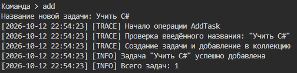
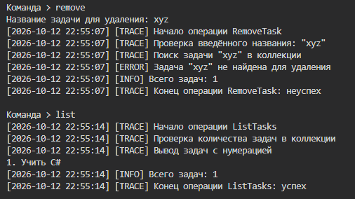
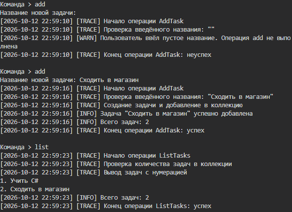
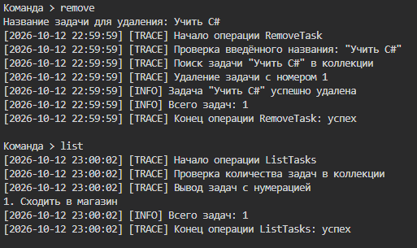
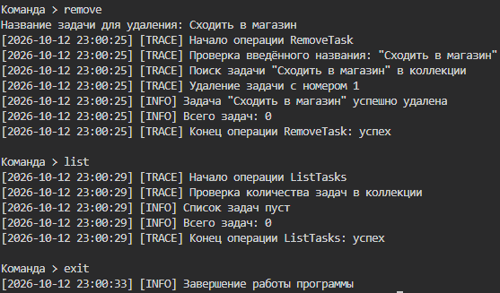
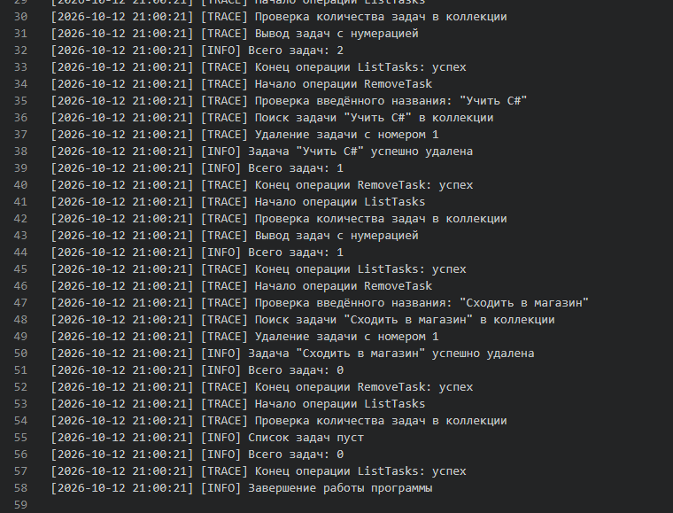

# КТ-1.3 - Управление задачами с логированием и трассировкой

Студент - Денисенко Даниил Евгеньевич  
Группа - 4п4.23 NET  
Дисциплина - Логирование и трассировка C#  

### Задания

Тип приложения: консольное приложение .NET (C#)Цель: управление списком задач с базовым логированием и возможностью трассировки операций.

Задачи на проект:

Реализовать базовые операции по управлению тасками: создание, удаление, вывод списка.Настроить и продемонстрировать логирование ключевых событий.Настроить трассировку - простейшее пошаговое отслеживание выполнения операций.

Результатом прикрепить отчет:

ссылка на проект (github публичный);скриншоты отражающие исполненный сценарий использования подобный прикрепленному ниже;документ с логами.

### Задание 1

Сделал консольное приложение на .NET 10 с командами add, remove, list, help и exit
Задачи хранятся в `List<Task>` во время работы программы
Название проверяется на пустой ввод, длину больше 100 символов и управляющие символы
При удалении название сравнивается без учёта регистра

Программа запущена, задача «Учить C#» добавлена, количество задач равно 1

Задача «xyz» не найдена, в списке осталась задача «Учить C#»

Пустое название отклонено, добавлена задача «Сходить в магазин», список содержит две задачи с номерами

Задача «Учить C#» удалена, оставшаяся задача «Сходить в магазин» имеет номер 1

Последняя задача удалена, список пуст, программа завершила работу по команде exit

### Задание 2

Добавил логирование через System.Diagnostics
Information отмечает запуск, завершение, успешные операции и количество задач
Warning отмечает некорректное название, Error сообщает об удалении несуществующей задачи
Сообщения с датой и временем выводятся в консоль и сохраняются в отдельный TXT-файл каждого запуска
Если файл недоступен, программа сообщает об ошибке и продолжает вывод в консоль

Документ с логами выполненного сценария: [logs.txt](report/logs.txt)

В документе представлены события INFO, WARN, ERROR и шаги TRACE

### Задание 3

Добавил трассировку в методы AddTask, RemoveTask и ListTasks
Метка [TRACE] показывает начало операции, проверку данных, работу с коллекцией и конец с результатом
При отклонении названия или отсутствии задачи операция заканчивается с результатом «неуспех»

Код: [Program](Program.cs), [Task](Task.cs), [TaskManager](TaskManager.cs), [TaskTraceListener](TaskTraceListener.cs)
